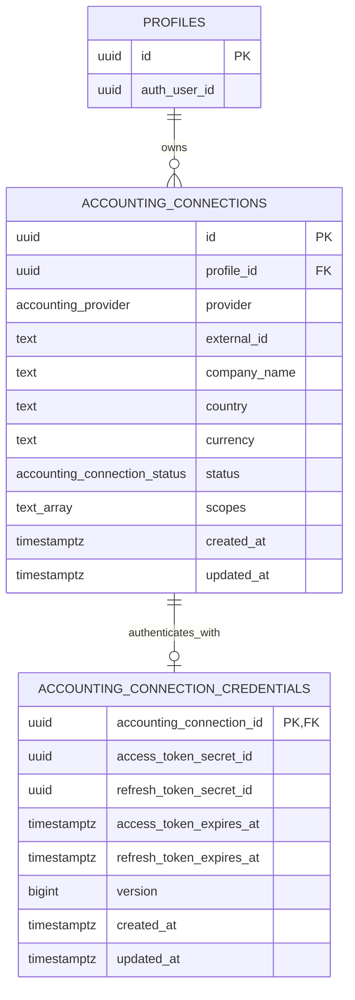

# Accounting Connections — Database Design

## Purpose

CashLens connects an authenticated CashLens profile to one or more external accounting companies.

Slice 3b implements QuickBooks Online first, but the database model intentionally uses provider-neutral naming so another accounting provider such as Xero can be added later without redesigning the core connection tables.

The scope of this model is deliberately limited to:

- accounting-company identity and display metadata
- OAuth connection state
- granted OAuth scopes
- secure OAuth credential references
- low-cost preparation for future token-refresh concurrency

Financial-data synchronization, sync health, webhook processing, client/company domain modelling, and retention workflows are future concerns.

---

## Entity model



---

## Identity model

CashLens owns its own stable connection ID.

The external provider identifier is used only at the integration boundary.

```text
QuickBooks / external provider
        |
        | provider + external_id
        | QUICKBOOKS + realmId
        v
+--------------------------------+
| accounting_connections         |
|                                |
| id = CashLens-owned UUID       |
+---------------+----------------+
                |
                | internal ownership key
                v
        Future CashLens data
        +-- sync runs
        +-- reports
        +-- accounts
        +-- imported financial data
```

For QuickBooks:

```text
provider    = QUICKBOOKS
external_id = realmId
```

A future Xero connection could use:

```text
provider    = XERO
external_id = tenantId
```

All future CashLens-owned synchronized data should reference:

```text
accounting_connections.id
```

rather than the external provider identifier.

This keeps provider-specific identifiers from leaking throughout the CashLens domain model and gives CashLens a stable internal ownership boundary.

That internal ID may later be useful for:

- synchronization ownership
- client offboarding
- retention workflows
- purging imported financial data
- audit/event relationships

---

## Cardinality

A CashLens profile may own many accounting connections.

This supports cases such as an accountant or accounting practice managing multiple QuickBooks companies.

```text
Profile A
  +-- QuickBooks Company 123
  +-- QuickBooks Company 456
  +-- QuickBooks Company 789
```

Each external accounting company can belong to only one CashLens connection at a time.

---

## External company uniqueness

An external accounting company is uniquely identified by:

```text
provider + external_id
```

The database enforces:

```sql
create unique index accounting_connections_provider_external_id_key
  on cashlens.accounting_connections (provider, external_id);
```

This prevents:

```text
Profile A -> QUICKBOOKS / 123
Profile B -> QUICKBOOKS / 123   X
```

regardless of whether the existing connection is currently `CONNECTED` or `DISCONNECTED`.

A company must be removed from its existing CashLens profile before another profile can connect it.

---

## Connection lifecycle

The connection lifecycle is intentionally small.

```text
CONNECTED
    |
    | disconnect
    v
DISCONNECTED
    |
    | remove from CashLens
    v
hard delete
```

The persisted statuses are:

```text
CONNECTED
DISCONNECTED
```

There is deliberately no `DELETED` status.

Deleting a connection means deleting the connection record rather than introducing a soft-delete lifecycle.

This keeps authorization state separate from audit or retention concerns.

If historical/audit requirements appear later, they should be modelled separately rather than keeping deleted connection records in the active connection table.

---

## Provider

`provider` is a PostgreSQL enum.

Initial value:

```text
QUICKBOOKS
```

The table is intentionally named:

```text
accounting_connections
```

rather than:

```text
quickbooks_connections
```

so another provider such as Xero can be added later without redesigning the core connection model.

This is only a database-level extensibility point.

Slice 3b does not introduce:

- generic provider services
- provider interfaces
- integration frameworks
- unnecessary application abstractions

QuickBooks-specific application code can remain QuickBooks-specific until another provider creates a real need for abstraction.

---

## External lookup

External systems identify companies using their own provider-specific identifiers.

For QuickBooks, CashLens receives a `realmId`.

A future webhook or provider callback can resolve that external identifier using:

```sql
select *
from cashlens.accounting_connections
where provider = 'QUICKBOOKS'
  and external_id = :realm_id;
```

Because `(provider, external_id)` is uniquely indexed, the lookup is both fast and guaranteed to return at most one connection.

After resolving it, all downstream CashLens processing should use:

```text
accounting_connections.id
```

```text
QuickBooks event
      |
      | realmId
      v
provider + external_id lookup
      |
      v
accounting_connections.id
      |
      v
internal CashLens processing
```

---

## Connection status

Initial status values are:

```text
CONNECTED
DISCONNECTED
```

The column has no database default.

The caller must explicitly choose the state when creating or updating a connection.

This avoids accidentally treating an incompletely initialized connection as connected.

For the initial OAuth flow, a successful connection will explicitly persist:

```text
status = CONNECTED
```

Status represents the authorization/connection lifecycle only.

It must not be overloaded with future synchronization-health concepts.

For example, a future connection may legitimately have:

```text
status: CONNECTED
last successful sync: 5 days ago
health: unhealthy
```

Sync health belongs to a later synchronization slice.

---

## Granted OAuth scopes

Granted OAuth scopes are stored as:

```text
scopes text[]
```

For the initial QuickBooks integration this will normally contain:

```text
com.intuit.quickbooks.accounting
```

Scopes are intentionally not stored as a PostgreSQL enum.

Unlike provider and connection status, OAuth scopes are defined by external providers and may change independently of CashLens.

Using `text[]` avoids requiring schema migrations every time a provider introduces a new scope.

Persisting granted scopes lets CashLens compare:

```text
scopes required by the current application
```

with:

```text
scopes granted to this connection
```

If CashLens later requires an additional scope, existing companies missing that scope can be identified as requiring reauthorization.

Scopes are retained while a connection is disconnected because they describe the most recent authorization.

---

## Company metadata

CashLens stores a small local snapshot of useful provider metadata:

```text
company_name
country
currency
```

`company_name` is used directly in the CashLens UI.

`country` and `currency` are optional metadata that may become useful for display or financial reporting.

The external accounting provider remains the source of truth.

Refreshing these values when they change at the provider is deliberately deferred to a later synchronization slice.

CashLens should not copy additional company information unless the application has a concrete use for it.

---

## Credential separation

OAuth credentials are intentionally separated from normal connection metadata.

```text
accounting_connections
        |
        | 1 : 0..1
        v
accounting_connection_credentials
        |
        +-- access_token_secret_id
        |
        +-- refresh_token_secret_id
```

The separation reflects two different lifecycles.

Connection metadata changes relatively infrequently:

```text
provider
external_id
company_name
status
scopes
```

Credentials rotate more frequently:

```text
access token
refresh token
expiry timestamps
version
```

This also means normal application queries can read connection information without touching credential metadata.

---

## Token encryption

Raw QuickBooks OAuth tokens are not stored directly in CashLens tables.

The credentials table stores only references:

```text
access_token_secret_id
refresh_token_secret_id
```

The actual token values are stored encrypted in Supabase Vault.

```text
accounting_connection_credentials
          |
          +-- access_token_secret_id
          |          |
          |          v
          |    Supabase Vault
          |    encrypted access token
          |
          +-- refresh_token_secret_id
                     |
                     v
               Supabase Vault
               encrypted refresh token
```

Tokens must never be:

- sent to Client Components
- returned to the browser
- stored in browser-accessible environment variables
- logged
- stored as plaintext columns in CashLens tables

Decrypted token access must remain server-side.

---

## Credential model

The credentials record is a strict child of an accounting connection.

```text
cashlens.accounting_connection_credentials
```

contains:

```text
accounting_connection_id
access_token_secret_id
refresh_token_secret_id
access_token_expires_at
refresh_token_expires_at
version
created_at
updated_at
```

`accounting_connection_id` is both:

```text
PRIMARY KEY
```

and:

```text
FOREIGN KEY -> accounting_connections.id
```

This naturally models a one-to-one relationship.

There is no need for another internal UUID for the credential record.

---

## Credential version

The credentials row contains:

```text
version bigint not null default 1
```

Slice 3b does not implement token refresh yet.

The version is retained because it is a low-cost preparation for optimistic concurrency when token refresh is introduced.

A future refresh flow can use:

```text
read credentials
version = 7

        |
        v

refresh tokens with provider

        |
        v

update credentials
where version = 7

        |
        v

version = 8
```

If another process updated the credentials while the refresh was in progress, the stale update would affect zero rows instead of overwriting newer token state.

This solves stale database writes.

Preventing two workers from calling the provider's refresh endpoint simultaneously is a separate problem.

If concurrent background workers are introduced later, CashLens may add a short-lived refresh lease or another coordination mechanism.

---

## Credential timestamps

The credentials table contains:

```text
created_at
updated_at
```

`updated_at` represents the last time anything about the credential metadata changed.

There is deliberately no:

```text
refreshed_at
```

column in Slice 3b.

If a dedicated token-refresh timestamp becomes useful when refresh is implemented, it can be introduced then.

---

## Disconnect behaviour

Disconnecting a QuickBooks company should conceptually:

```text
revoke/disconnect provider authorization
        |
        v
remove Vault secrets
        |
        v
remove credential row
        |
        v
accounting_connections.status = DISCONNECTED
```

The connection metadata remains so CashLens can still display the disconnected accounting company.

The company remains owned by that CashLens profile while the connection row exists.

---

## Removing a connection

Removing a connection from CashLens performs a hard delete.

Conceptually:

```text
CONNECTED
    |
    v
disconnect
    |
    v
DISCONNECTED
    |
    v
delete accounting connection
```

Once the `accounting_connections` row is removed, the same:

```text
provider + external_id
```

may be connected to another CashLens profile.

The lifecycle of previously synchronized financial data is a separate concern.

When synchronization is introduced, CashLens must explicitly decide whether synced data is:

- retained
- archived
- scheduled for later deletion
- immediately deleted

Connection deletion alone should not accidentally determine the application's future data-retention policy.

---

## Future synchronization health

Connection status and synchronization health are separate concepts.

A QuickBooks connection may still appear authorized while synchronization has silently failed for several days.

A future synchronization slice may introduce fields or entities representing concepts such as:

```text
last_sync_attempt_at
last_successful_sync_at
last_sync_status
last_sync_error
```

This could allow CashLens to display:

```text
Connection: CONNECTED
Health: UNHEALTHY
Last successful sync: 5 days ago
```

Those fields intentionally do not exist in Slice 3b.

---

## Access model

### `accounting_connections`

Authenticated users may read connection metadata belonging to their CashLens profile.

Creation and mutation are server-controlled.

### `accounting_connection_credentials`

Credential metadata is server-only.

Browser-facing roles should not receive direct access.

RLS remains enabled as defense in depth.

### Supabase Vault

Vault is outside the normal browser-facing CashLens data model.

Only trusted server-side integration code should retrieve decrypted token values.

---

## Deliberately deferred

The following concerns are intentionally not part of Slice 3b:

- QuickBooks financial-data synchronization
- synchronization-health fields
- `last_successful_sync_at`
- sync error history
- background jobs
- webhook implementation
- token refresh implementation
- refresh leases / distributed locking
- token history
- company-metadata refresh scheduling
- first-class CashLens client/company entities
- provider abstraction layers
- formal offboarding workflows
- financial-data retention policies

These should be introduced when their corresponding application slices create an actual requirement.
