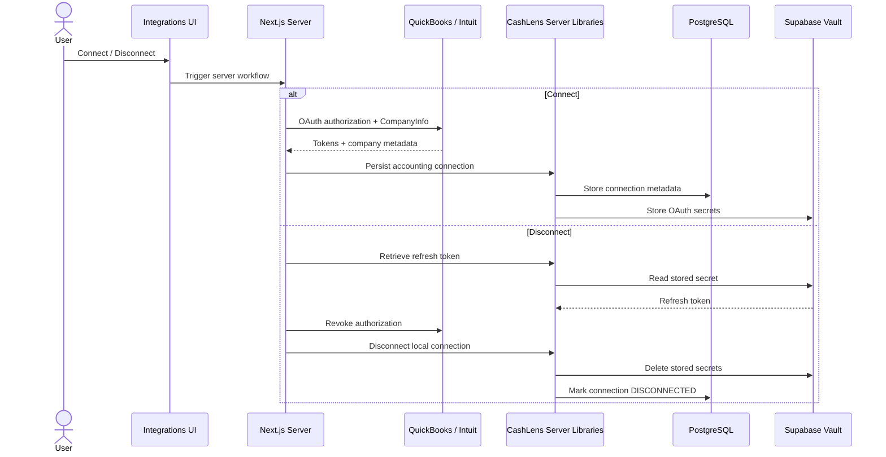
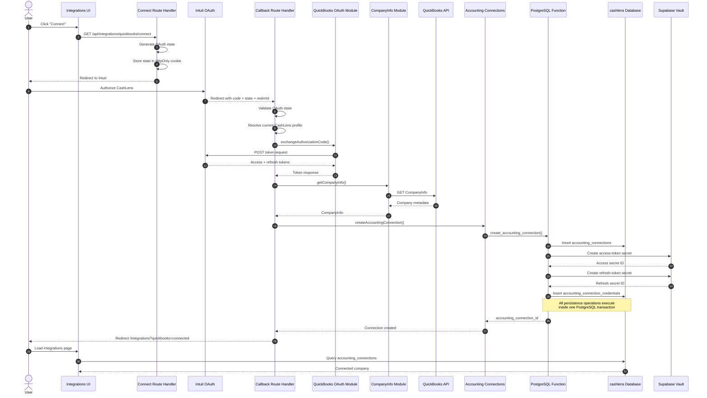
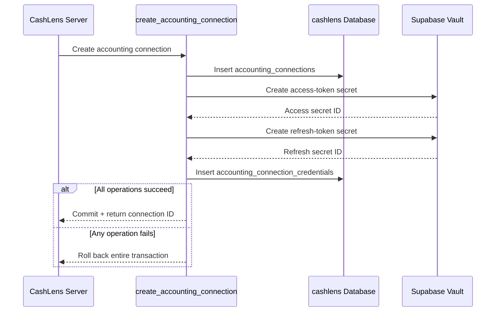
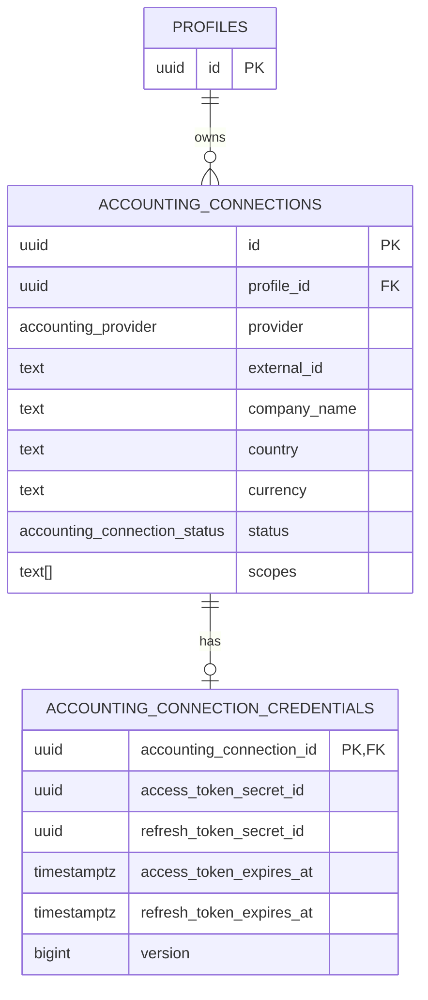
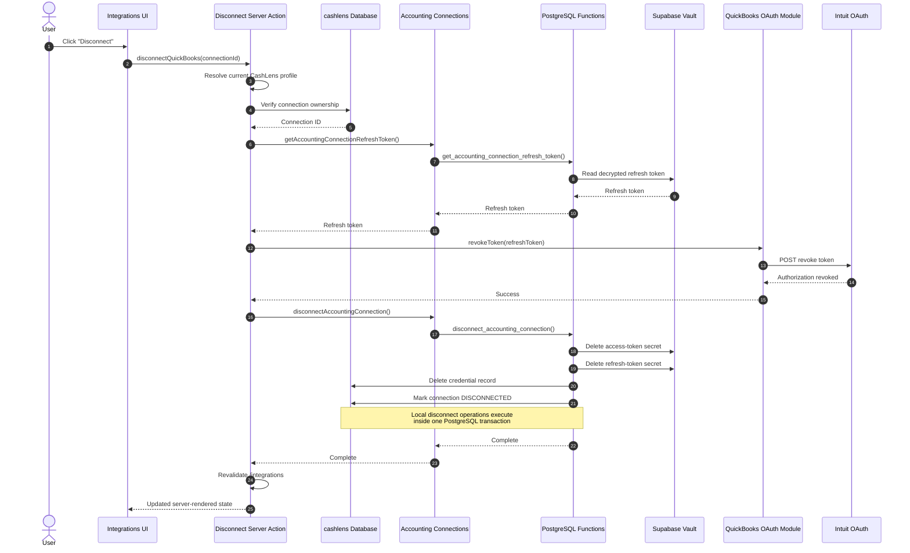
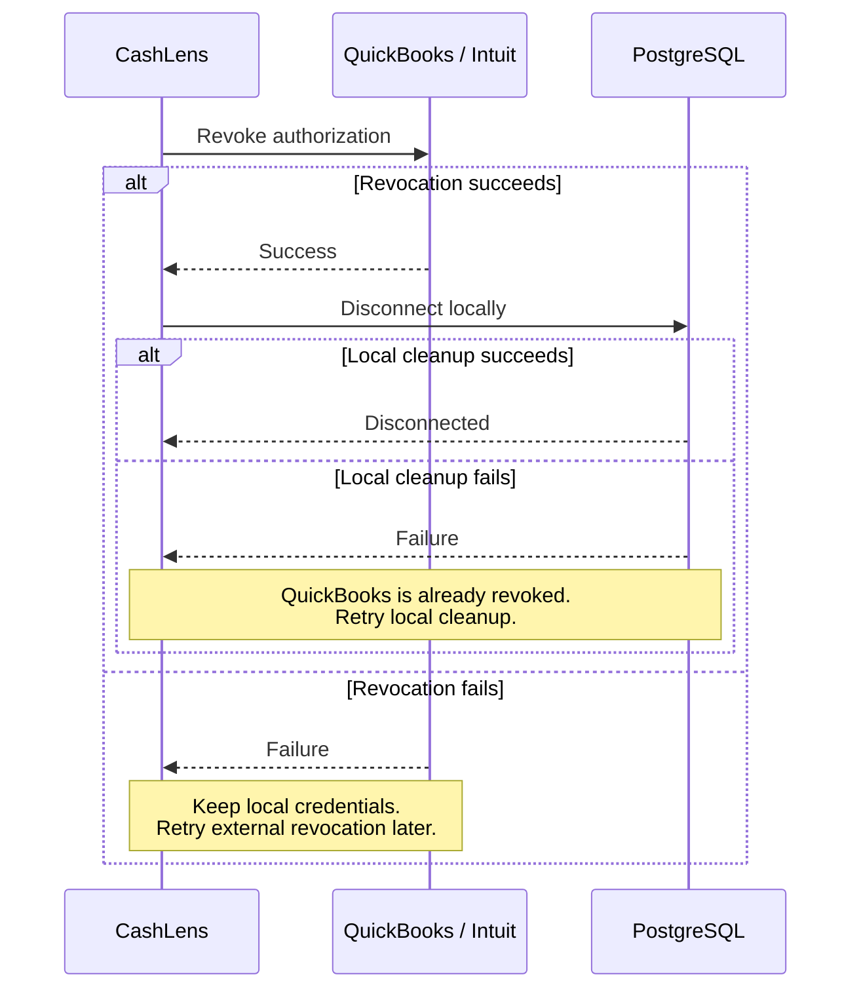

# QuickBooks Connection Lifecycle

This document describes the architecture and component interactions involved when connecting and disconnecting a QuickBooks company from CashLens.

It is intended as a quick reference for development and troubleshooting.

## Architecture Overview

CashLens separates responsibilities across the frontend, Next.js server layer, QuickBooks integration modules, provider-neutral accounting connection modules, PostgreSQL, and Supabase Vault.

The high-level interaction looks like this:



## Responsibility Boundaries

```text
Integrations UI
→ displays connection state
→ starts connect/disconnect actions

Route Handlers / Server Actions
→ orchestrate application workflows
→ authenticate the current CashLens user
→ verify ownership before privileged operations

src/lib/quickbooks/
→ QuickBooks-specific OAuth and API behavior

src/lib/accounting-connections/
→ provider-neutral CashLens connection operations

PostgreSQL functions
→ transactional persistence
→ controlled Supabase Vault access

Supabase Vault
→ encrypted OAuth token storage

cashlens PostgreSQL schema
→ connection metadata and credential references
```

---

# Connect Sequence

The connection flow begins from the authenticated Integrations page.



## Connect Components

### Integrations UI

Typical location:

```text
src/app/(authenticated)/integrations/
```

Responsibilities:

- display QuickBooks connection state
- expose the Connect action
- display the connected company
- show callback success/error state

It does not handle OAuth tokens or provider credentials.

### Connect Route Handler

Typical route:

```text
/api/integrations/quickbooks/connect
```

Responsibilities:

- require an authenticated CashLens session
- generate OAuth `state`
- store `state` in an HTTP-only cookie
- build the Intuit authorization URL
- redirect the browser to Intuit

### Callback Route Handler

Typical route:

```text
/api/integrations/quickbooks/callback
```

Responsibilities:

- validate OAuth callback parameters
- validate `state`
- resolve the current CashLens profile
- exchange the authorization code
- retrieve QuickBooks company information
- orchestrate connection persistence
- redirect back into the application

The callback should remain orchestration-focused.

QuickBooks HTTP implementation belongs in:

```text
src/lib/quickbooks/
```

and persistence operations belong in:

```text
src/lib/accounting-connections/
```

### QuickBooks OAuth Module

```text
src/lib/quickbooks/oauth/
```

Current responsibilities include:

```text
exchange-authorization-code.ts
revoke-token.ts
```

The module owns QuickBooks OAuth protocol details such as:

- endpoints
- Basic authentication
- request formats
- response validation

### QuickBooks CompanyInfo Module

```text
src/lib/quickbooks/company-info/
```

Responsible for retrieving and validating the subset of QuickBooks CompanyInfo currently required by CashLens.

### Accounting Connection Module

```text
src/lib/accounting-connections/
```

The module provides the CashLens-facing persistence boundary.

Examples:

```text
create-accounting-connection.ts
disconnect-accounting-connection.ts
get-accounting-connection-refresh-token.ts
```

These operations remain provider-neutral where possible.

---

# Connection Persistence

Connection persistence spans several database operations:



A PostgreSQL function is used because these writes must be atomic.

An application implementation such as:

```text
HTTP request → insert connection
HTTP request → create access secret
HTTP request → create refresh secret
HTTP request → insert credentials
```

would not provide one transaction across all four operations.

## Stored Connection Data



The credential records contain only Vault references, not raw OAuth token values.

---

# Disconnect Sequence

Disconnecting requires both external and local cleanup.

Local deletion alone is insufficient because Intuit would still consider CashLens authorized.



## Why QuickBooks Is Revoked First

The operation intentionally uses this order:

```text
retrieve refresh token
        |
        v
revoke QuickBooks authorization
        |
        v
delete local credentials
```

and not:

```text
delete local credentials
        |
        v
attempt QuickBooks revocation
```

Once the Vault credentials have been deleted, CashLens may no longer have the credential required to revoke the external authorization.

Keeping the token until Intuit confirms revocation allows the operation to be retried if the external call fails.

---

# Distributed Transaction Boundary

The complete disconnect operation cannot be one atomic transaction because it spans two independent systems:

```text
Intuit / QuickBooks
+
PostgreSQL / Supabase
```

There is no distributed transaction between them.

The selected ordering favors recoverability:



This results in two useful failure modes.

### QuickBooks revoke fails

```text
QuickBooks authorization still active
local credentials still exist
local connection still CONNECTED
```

The operation can be retried because CashLens still has the refresh token.

### Local cleanup fails after QuickBooks revoke succeeds

```text
QuickBooks authorization revoked
local connection may still appear CONNECTED
```

The external authorization is already safe.

The local disconnect operation is designed to be idempotent and can be retried.

---

# Security Boundaries

## Browser Data Is Untrusted

The disconnect button passes an accounting connection ID to the Server Action.

That ID must not be trusted simply because it originated from a server-rendered page.

Before privileged operations, CashLens verifies:

```text
connection.id = requested ID
AND
connection.profile_id = current profile
AND
connection.provider = QUICKBOOKS
```

Only after ownership verification does the application use the service-role-backed operations.

## Service Role

Privileged database functions are not callable by:

```text
public
anon
authenticated
```

They are restricted to:

```text
service_role
```

The service role is only used in trusted server-side code.

## Vault

Raw OAuth tokens:

- never reach Client Components
- are never included in callback URLs
- are not stored in normal CashLens tables
- should not be logged
- are decrypted only when an explicit server-side use case requires them

---

# Troubleshooting Guide

## User returns from QuickBooks but connection is not created

Check the flow in this order:

```text
1. OAuth state validation
2. authenticated CashLens profile
3. authorization-code exchange
4. QuickBooks CompanyInfo request
5. create_accounting_connection RPC
6. accounting_connections row
7. accounting_connection_credentials row
8. Vault secrets
```

Useful database checks:

```sql
select *
from cashlens.accounting_connections
order by created_at desc;
```

```sql
select *
from cashlens.accounting_connection_credentials
order by created_at desc;
```

Inspect Vault metadata without exposing plaintext secrets:

```sql
select
  id,
  name,
  description,
  created_at
from vault.secrets
order by created_at desc;
```

Expected Vault names resemble:

```text
QUICKBOOKS:<connection-id>:access-token
QUICKBOOKS:<connection-id>:refresh-token
```

## Connection creation fails

`create_accounting_connection()` is transactional.

If any of these fail:

```text
connection insert
Vault access-token creation
Vault refresh-token creation
credential insert
```

the entire operation should roll back.

Check the PostgreSQL/Supabase error returned by the RPC.

Do not inspect or log raw token values while troubleshooting.

## Disconnect fails before local cleanup

Check:

```text
ownership verification
        |
        v
refresh-token retrieval
        |
        v
QuickBooks revoke API
```

If QuickBooks revocation fails, CashLens intentionally retains the local credentials.

## Disconnect succeeds in QuickBooks but UI remains connected

The likely failure occurred during:

```text
disconnect_accounting_connection()
```

Check:

```text
accounting_connections.status
accounting_connection_credentials
Vault secret records
```

The local disconnect can safely be retried.

## `public.<function>` not found

Accounting connection RPC functions live in the `cashlens` schema.

Application calls should use:

```ts
supabase
  .schema("cashlens")
  .rpc(...)
```

rather than:

```ts
supabase.rpc(...)
```

which defaults to the `public` schema.

---

# Current Known Limitations

The current lifecycle does not yet include:

- reconnecting a disconnected company
- automatic access-token refresh
- background token refresh
- synchronized financial data
- sync-health tracking
- retry queues
- webhook handling

These capabilities should build on the connection lifecycle described here rather than changing its core ownership and credential boundaries.
