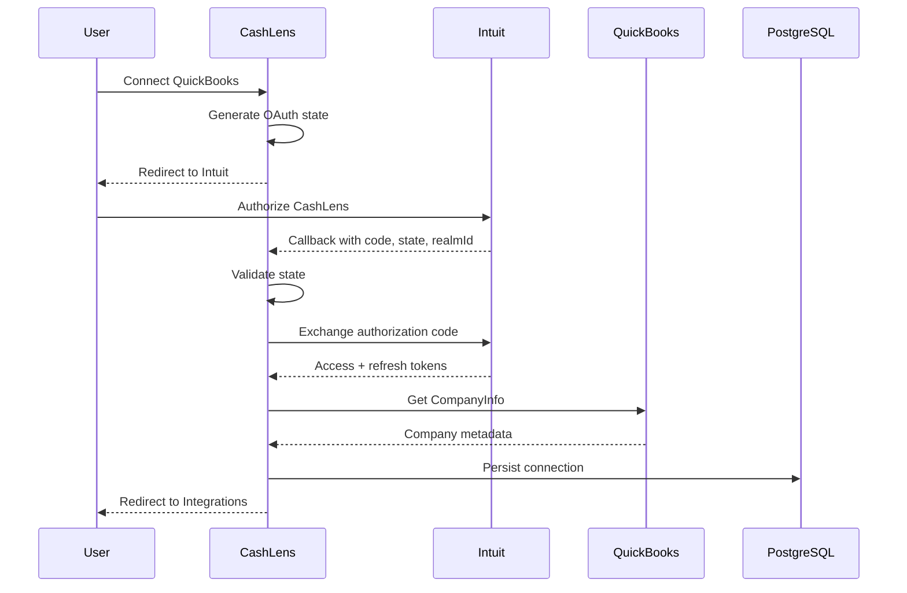
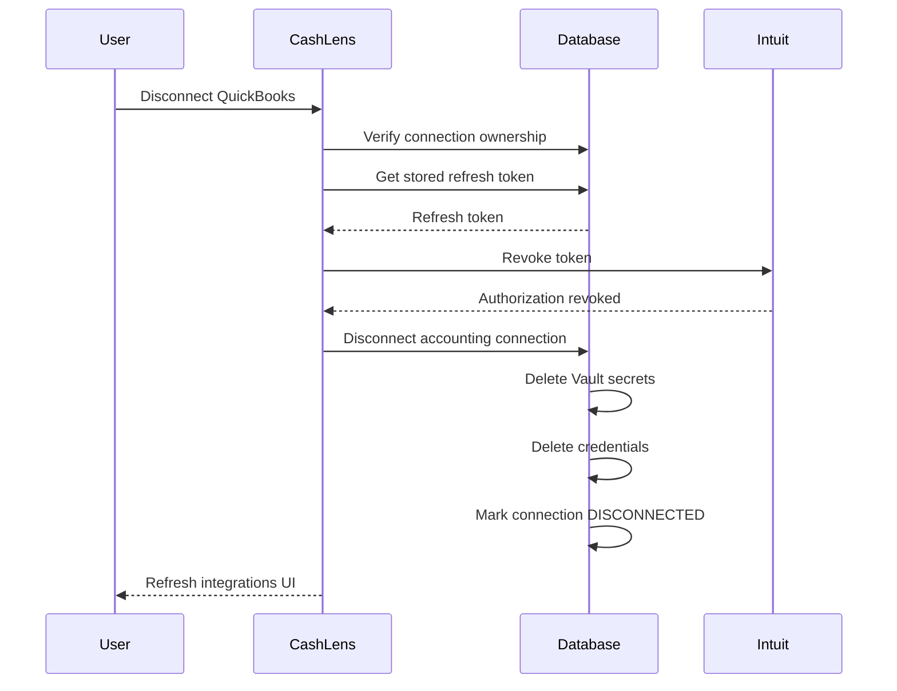

# Slice 3b — QuickBooks OAuth

## Overview

Slice 3b adds the first external accounting integration to CashLens.

The goal of this slice was not only to complete OAuth authentication with QuickBooks, but to implement the full connection lifecycle:

```text
CashLens user
    |
    v
Connect to QuickBooks
    |
    v
QuickBooks authorization
    |
    v
OAuth callback
    |
    v
Exchange authorization code
    |
    v
Retrieve company information
    |
    v
Persist connection + encrypted credentials
    |
    v
Show connected company
    |
    v
Disconnect
    |
    v
Revoke QuickBooks authorization
    |
    v
Remove local credentials
```

By the end of the slice, a CashLens user can connect a QuickBooks company, securely persist the authorization, see the connected company in the application, and disconnect it again.

## Goals

This slice focused on learning and implementing:

- OAuth authorization code flow
- OAuth `state` validation
- QuickBooks company identity through `realmId`
- server-to-server token exchange
- calling authenticated QuickBooks APIs
- secure token storage with Supabase Vault
- provider-neutral accounting connection modelling
- transactional PostgreSQL functions
- privileged server-side Supabase operations
- external authorization revocation
- connected and disconnected UI states
- integration failure boundaries

The implementation intentionally remained small and pragmatic rather than introducing a large integration framework.

## QuickBooks OAuth Flow

The OAuth flow begins when the authenticated user chooses to connect QuickBooks.



### OAuth State

Before redirecting to Intuit, CashLens generates a cryptographically random OAuth `state` value.

The value is stored in an HTTP-only cookie.

When Intuit redirects back to CashLens, the callback compares the returned `state` with the stored value.

```text
generated state
      |
      v
HTTP-only cookie
      |
      v
Intuit authorization
      |
      v
callback state
      |
      v
must match
```

This protects the callback from unsolicited or forged OAuth responses.

The state cookie is deleted when the callback is processed.

## OAuth Callback

The QuickBooks callback is implemented as a Next.js Route Handler:

```text
/api/integrations/quickbooks/callback
```

Although the callback URL is publicly reachable because Intuit must redirect the browser to it, the operation itself still requires a valid CashLens session before a connection can be persisted.

The callback performs orchestration rather than containing provider or persistence implementation details.

Its responsibilities are:

```text
validate callback
        |
        v
resolve CashLens profile
        |
        v
exchange authorization code
        |
        v
retrieve QuickBooks company info
        |
        v
persist accounting connection
        |
        v
redirect back to /integrations
```

Expected OAuth failures are converted into application-level redirect states rather than exposing raw JSON responses to the browser.

Example:

```text
/integrations?quickbooks=connected
```

or:

```text
/integrations?quickbooks=error&reason=connection_failed
```

Raw OAuth provider errors, authorization codes, and token values are never placed in the redirect URL.

## Token Exchange

CashLens uses the native `fetch` API rather than the Intuit OAuth SDK.

The implementation lives under:

```text
src/lib/quickbooks/oauth/
├── exchange-authorization-code.ts
├── revoke-token.ts
└── index.ts
```

Using `fetch` keeps the OAuth protocol visible while learning and avoids introducing an SDK abstraction around a relatively small HTTP operation.

The authorization code exchange sends:

```text
grant_type=authorization_code
code=<authorization-code>
redirect_uri=<callback-url>
```

with the QuickBooks client ID and client secret supplied through HTTP Basic authentication.

The response includes:

- access token
- refresh token
- access-token expiry
- refresh-token expiry

Raw token values are never logged or returned to the browser.

## Token Expiry

QuickBooks returns token expiry durations in seconds.

JavaScript timestamps use milliseconds, so CashLens converts the values when calculating expiry timestamps:

```ts
const accessTokenExpiresAt = new Date(Date.now() + tokens.expires_in * 1000);
```

The same approach is used for the refresh token.

The resulting absolute timestamps are stored rather than repeatedly calculating expiry from the original OAuth response.

## QuickBooks Company Identity

QuickBooks returns a `realmId` during OAuth.

For CashLens, this identifies the external QuickBooks company.

The provider-neutral CashLens database model stores this value as:

```text
external_id
```

so the model is not coupled to QuickBooks terminology.

```text
QuickBooks realmId
        |
        v
accounting_connections.external_id
```

This allows a future provider such as Xero to use the same model with its own external company identifier.

## CompanyInfo

After exchanging the authorization code, CashLens retrieves QuickBooks `CompanyInfo`.

The integration only models the fields currently needed by CashLens.

Example:

```ts
const companyInfoResponseSchema = z.object({
  CompanyInfo: z.object({
    CompanyName: z.string().min(1),
    Country: z.string().optional(),
  }),
});
```

CashLens deliberately does not model the complete QuickBooks response.

This keeps the application coupled only to fields it genuinely uses.

## Provider-Specific Types

Types inside a provider module use concise names.

Example:

```ts
import type { CompanyInfo } from "@/lib/quickbooks/company-info";
```

rather than:

```ts
QuickBooksCompanyInfo;
```

The provider context is already communicated by the import path.

If a consumer later needs equivalent models from multiple providers, aliases can be introduced at the import site:

```ts
import type { Invoice as QuickBooksInvoice } from "@/lib/quickbooks/invoices";

import type { Invoice as XeroInvoice } from "@/lib/xero/invoices";
```

If CashLens later introduces a provider-neutral invoice model, that should be a separate CashLens-owned domain type rather than one provider's API model.

## Accounting Connection Model

CashLens stores provider connections independently from QuickBooks-specific code.

The stable connection record is represented by:

```text
cashlens.accounting_connections
```

The connection contains information such as:

- CashLens profile ID
- provider
- external company ID
- company name
- country
- currency
- status
- OAuth scopes

The provider and external company identifier are unique together.

Conceptually:

```text
CashLens profile
      |
      v
accounting_connections
      |
      +-- provider = QUICKBOOKS
      |
      +-- external_id = realmId
      |
      +-- status = CONNECTED / DISCONNECTED
```

The internal `accounting_connections.id` is the canonical CashLens identifier for downstream data.

Future synchronized financial data should reference this internal ID rather than the external QuickBooks `realmId`.

## Credential Model

Frequently changing OAuth credentials are stored separately from stable connection metadata:

```text
cashlens.accounting_connection_credentials
```

The credential row contains:

- accounting connection ID
- access-token secret ID
- refresh-token secret ID
- access-token expiry
- refresh-token expiry
- credential version

The raw token values are not stored in normal CashLens tables.

## Supabase Vault

OAuth token values are stored in Supabase Vault.

The credential table stores only the Vault secret IDs.

```text
accounting_connection_credentials
          |
          +-- access_token_secret_id
          |          |
          |          v
          |     vault.secrets
          |
          +-- refresh_token_secret_id
                     |
                     v
                vault.secrets
```

Vault secrets are named using provider and connection metadata to simplify operational troubleshooting.

Example:

```text
QUICKBOOKS:<connection-id>:access-token
QUICKBOOKS:<connection-id>:refresh-token
```

Descriptions include additional information such as the external company ID.

## Transactional Connection Persistence

Creating an accounting connection requires several writes:

```text
insert accounting connection
        |
        v
create access-token Vault secret
        |
        v
create refresh-token Vault secret
        |
        v
insert credential record
```

Performing these as independent Supabase HTTP requests could leave partially created state if one step failed.

For example:

```text
connection inserted
access token stored
refresh token fails
```

CashLens therefore performs this operation using a PostgreSQL function:

```text
cashlens.create_accounting_connection(...)
```

The function executes all database and Vault operations inside one PostgreSQL transaction.

If any step fails, the complete operation rolls back.

This is an intentional use of database-side logic because transaction atomicity is genuinely required.

## Database Functions as Boundaries

CashLens does not use PostgreSQL functions simply to move application code into the database.

Application logic remains in TypeScript unless the database provides a concrete advantage.

Current examples:

```text
create_accounting_connection
→ PostgreSQL function because transactional atomicity is required

get_accounting_connection_refresh_token
→ PostgreSQL function because Supabase Vault is a managed schema
  and decrypted secrets are intentionally not exposed through normal
  Data API access

disconnect_accounting_connection
→ PostgreSQL function because Vault cleanup + credential cleanup +
  status update should be atomic
```

Application-level orchestration remains outside the database.

## Server-Side Accounting Connection Operations

Provider-neutral CashLens connection operations live under:

```text
src/lib/accounting-connections/
```

Current operations include:

```text
create-accounting-connection.ts
disconnect-accounting-connection.ts
get-accounting-connection-refresh-token.ts
```

These modules are deliberately separate from:

```text
src/lib/quickbooks/
```

because accounting connections are CashLens concepts, not QuickBooks concepts.

This keeps the boundary clear:

```text
src/lib/quickbooks/
→ speaks to QuickBooks

src/lib/accounting-connections/
→ manages CashLens accounting connections

src/lib/supabase/
→ Supabase infrastructure clients
```

No repository or service layer was introduced because the current use cases do not require one.

## Privileged Operations

Vault and connection lifecycle functions are callable only through the Supabase service role.

They explicitly revoke execution from:

```text
public
anon
authenticated
```

and grant execution only to:

```text
service_role
```

Privileged operations are invoked only through trusted server-side CashLens code.

## Authorization Before Privileged Operations

A connection ID supplied by the browser must not be trusted by itself.

Before invoking a privileged disconnect operation, CashLens verifies that:

```text
connection.id = requested ID
AND
connection.profile_id = current CashLens profile
AND
connection.provider = QUICKBOOKS
```

Only after ownership is confirmed does CashLens call the privileged service-role operation.

This keeps authorization separate from elevated database access.

## Disconnect Flow

Disconnecting QuickBooks requires both external and local cleanup.

Deleting the local token alone is not sufficient because the application would remain authorized inside QuickBooks.

The final flow is:



CashLens uses the refresh token for revocation because it represents the longer-lived authorization relationship.

If QuickBooks revocation fails, local credentials are deliberately retained so the operation can be retried.

If QuickBooks revocation succeeds but local cleanup fails, the external authorization is already safely revoked and the local cleanup operation can be retried.

This is an example of an integration operation that cannot be made fully atomic because it spans an external provider and PostgreSQL.

## Idempotent Local Disconnect

The local database disconnect operation is designed to be tolerant of retries.

```text
credentials exist
→ delete credentials and Vault secrets
→ mark DISCONNECTED

credentials missing
→ mark DISCONNECTED

connection missing
→ no-op
```

This makes retry behavior simpler and safer.

## Integrations UI

The integrations page now reads the current QuickBooks connection directly from the server.

The page displays either:

```text
QuickBooks
Connect your QuickBooks company to CashLens.

[Connect]
```

or:

```text
QuickBooks
Connected to
<Company Name>

[Disconnect]
```

A direct Server Component query is currently used because the read operation is simple and does not yet justify another application abstraction.

If connection-query requirements become more complex or reusable later, they can be promoted into `src/lib/accounting-connections`.

## Route Loading State

The integrations page performs request-time Supabase queries.

A route-level:

```text
loading.tsx
```

provides a Suspense boundary and loading experience during client-side navigation.

This also prevents navigation from appearing frozen while uncached server data is being loaded.

## Environment Configuration

QuickBooks credentials are loaded through the typed server environment module.

Required server-side variables include:

```env
APP_BASE_URL=
SUPABASE_SECRET_KEY=
QUICKBOOKS_CLIENT_ID=
QUICKBOOKS_CLIENT_SECRET=
```

Public Supabase configuration remains in the client environment boundary.

Application code does not access `process.env` directly except for narrow framework-specific cases.

## Deferred UX Improvement — OAuth Callback Loading State

The current OAuth callback is a Route Handler.

While the callback is:

```text
exchanging the authorization code
retrieving company information
persisting credentials
```

the browser may temporarily display a transitional or blank page because the Route Handler has not yet returned a response.

A future UX improvement could use a dedicated UI callback route:

```text
/integrations/quickbooks/callback
```

that displays:

```text
Connecting to QuickBooks...
```

while server-side completion occurs.

This was deliberately deferred because the current implementation is functionally correct and introducing an intermediate callback page would add additional OAuth-state and authorization-code handling complexity.

## What This Slice Established

Slice 3b introduced several important architectural boundaries:

```text
QuickBooks integration
→ provider-specific API and OAuth logic

Accounting connections
→ provider-neutral CashLens domain

PostgreSQL functions
→ only where atomicity or managed-schema access requires them

Supabase Vault
→ raw secret storage

Server Actions / Route Handlers
→ application orchestration

Server Components
→ simple authenticated reads and UI state
```

The implementation remains deliberately small, but these boundaries provide a foundation for future Xero integration and financial synchronization.

## Final Slice 3b State

CashLens can now:

- initiate QuickBooks OAuth
- validate OAuth state
- exchange authorization codes securely
- retrieve QuickBooks company metadata
- persist provider-neutral accounting connections
- store OAuth tokens securely in Supabase Vault
- display the connected QuickBooks company
- revoke QuickBooks authorization
- remove local credentials
- mark connections as disconnected
- safely retry local disconnect operations

## Future Work

The next stages of CashLens can build on this foundation with:

- stored access-token retrieval
- access-token refresh
- reconnect behavior
- QuickBooks financial data retrieval
- invoice and transaction synchronization
- synchronization status and health
- background processing
- scheduled jobs
- Supabase Edge Functions
- Supabase Queues
- integration retry and reliability patterns
